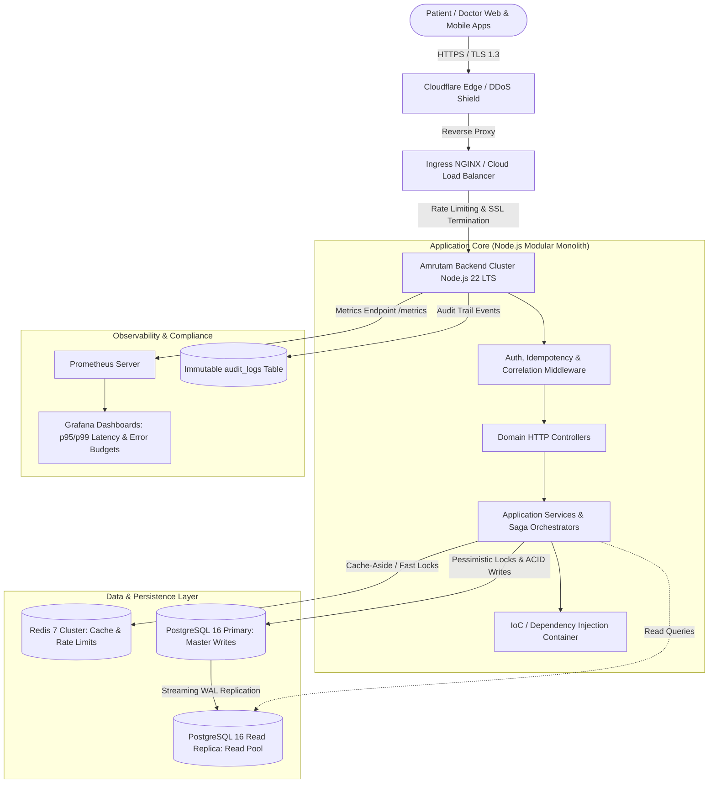
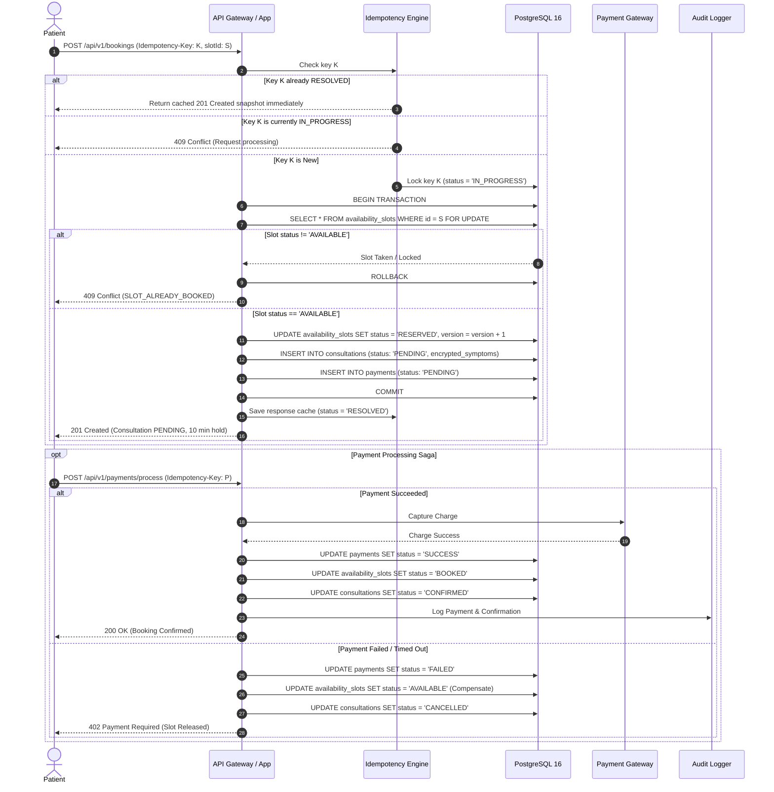
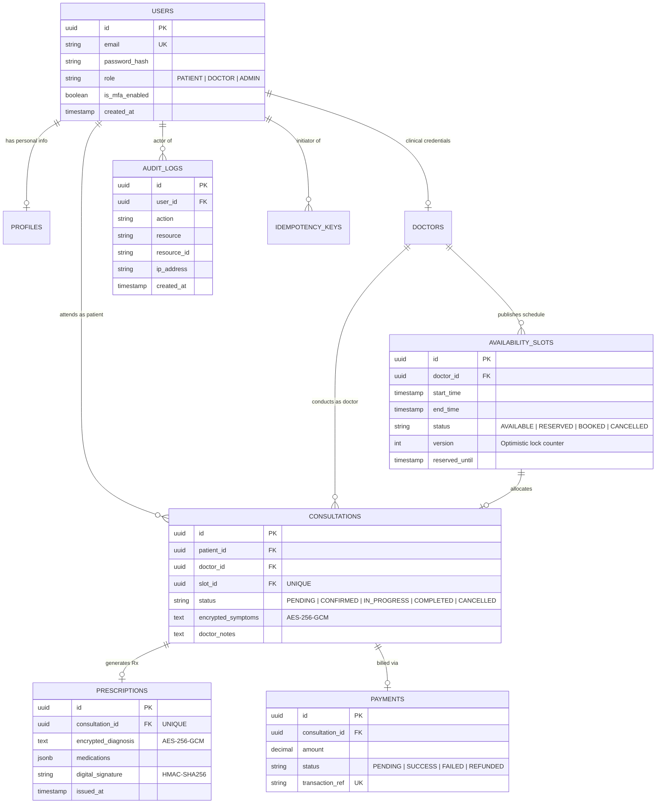

# Amrutam Telemedicine Backend: System Architecture & Design Specification

> **Scale:** 100,000 Daily Consultations | **Availability:** 99.95% | **Latency:** p95 <200ms (Reads), p95 <500ms (Writes)  
> **Security Baseline:** HIPAA / DISHA Aligned (AES-256-GCM PHI Encryption, Strict RBAC, Tamper-Evident Audit Trails)

---

## 1. High-Level Architecture & Data Flow

The system is designed as a modular, event-capable layered architecture. It cleanly decouples user-facing low-latency REST endpoints from transactional database operations and background asynchronous event processors.

### Scale Math & Capacity Planning
* **Consultations per Day:** 100,000 consultations.
* **Peak Booking Hours:** 70% of consultations occur in a 6-hour window ($70,000 / 21,600\text{ sec} \approx 3.25\text{ bookings/sec}$ sustained baseline).
* **Burst Factor:** Peak flash-sale or doctor slot opening traffic reaches **15x baseline $\approx 50\text{ writes/sec}$ and $500–1,000\text{ reads/sec}$**.
* **Database Connection Pool:** Sized at 20–50 connections per instance using PgBouncer for transactional connection pooling.

---

## 2. Booking Flow Sequence Diagram (Atomic Concurrency & Saga)

This diagram documents the zero double-booking guarantee and idempotent lifecycle:

---

## 3. Database Entity-Relationship (ER) Architecture

---

## 4. Concurrency Handling & Idempotency Engine

### A. Concurrency Protection Strategy
1. **Pessimistic Row-Level Locking:** During the critical booking transaction, the database locks the target slot row using `SELECT ... FOR UPDATE`. Competing transactions for the same slot serialize cleanly; the second transaction finds `status != 'AVAILABLE'` and exits immediately with an RFC-compliant `409 Conflict (SLOT_ALREADY_BOOKED)`.
2. **Version Counter:** Every update increments a `version` column (`version = version + 1`). This provides deterministic optimistic concurrency validation and audit tracking.
3. **Deadlock Avoidance:** All transaction queries acquire resources in a strict, fixed order: `availability_slots` $\rightarrow$ `consultations` $\rightarrow$ `payments`.

### B. Idempotency Protocol
* **Header Contract:** All state-altering write mutations require the `Idempotency-Key: <UUID | Client-Token>` header.
* **Storage Layer:** Atomic insertion in `idempotency_keys` table with status `IN_PROGRESS`.
* **Conflict Detection:** Concurrent identical keys receive `409 Conflict (IDEMPOTENCY_IN_PROGRESS)`.
* **Replay Cache:** Once resolved, subsequent retries bypass business logic and replay the cached HTTP response code and body directly with header `X-Idempotency-Status: REPLAYED`.

---

## 5. Retry, Circuit Breakers & Backoff Policies

To protect upstream dependencies (payment gateways, external SMS/Email providers) and database connections:

$$\text{Delay} = \min\left(M, B \cdot 2^{\text{attempt}}\right) \times (1 + \text{rand}(0, J))$$
* **Base Backoff ($B$):** 100ms
* **Max Cap ($M$):** 3,000ms
* **Jitter ($J$):** Full randomized jitter between 0% and 50% to prevent "Thundering Herd" stampedes on recovered systems.
* **Circuit Breaker:** Fails fast after 5 consecutive downstream timeouts within a 10-second window, opening the circuit for 30 seconds before testing a half-open canary request.

---

## 6. Data Partitioning & Sharding Strategy

With 100,000 consultations per day, `consultations` accumulates **36.5 million records annually**:

1. **Range Partitioning on `consultations`:**
   - Table is partitioned by `created_at` in monthly ranges: `consultations_y2026m10`, `consultations_y2026m11`, etc.
   - Queries filtering by date range target only relevant partitions, preserving sub-20ms index lookups.
2. **Hash Partitioning on `availability_slots`:**
   - Partitioned by `hash(doctor_id)` across 16 database partitions. All slot queries for a specific doctor map directly to a single partition.
3. **Cold Data Tiering:**
   - Completed consultations and prescriptions older than 365 days are asynchronously archived to encrypted cold object storage (S3 Glacier / Google Cloud Storage Archive) with query access through external read views, keeping active OLTP tables lean and fast.

---

## 7. Caching Strategy (Redis 7)

* **Cache-Aside Pattern:**
  - Doctor search queries with filter hashes (`specialization`, `rating`, `fee`) are cached in Redis with a 30–60 second TTL.
  - Active doctor availability slots are cached with cache invalidation triggered on slot reservation or booking confirmation.
* **Cache Stampede Prevention:**
  - Probabilistic early expiration (XFetch algorithm) refreshes hot doctor caches in the background before they expire.

---

## 8. Transaction Management & Sagas

Booking and Payment follow an **Orchestrated Saga Pattern**:

| Step | Service | Forward Action | Compensating Rollback Action |
|---|---|---|---|
| 1 | Slot Service | Reserve slot for 10 minutes (`status = 'RESERVED'`) | Release slot (`status = 'AVAILABLE'`) |
| 2 | Consultation Service | Create consultation record (`status = 'PENDING'`) | Update consultation (`status = 'CANCELLED'`) |
| 3 | Payment Service | Capture payment authorization | Refund transaction if captured |
| 4 | Notification Worker | Dispatch confirmation SMS & Email | Dispatch cancellation alert |

* **Slot Expiration Daemon:** A scheduled background job sweeps for slots where `status = 'RESERVED' AND reserved_until < NOW()` every 60 seconds, triggering automated compensation for abandoned carts.

---

## 9. Backup & Disaster Recovery (DR) Strategy

* **Recovery Objectives:**
  * **RPO (Recovery Point Objective):** $< 5\text{ minutes}$ (maximum acceptable data loss).
  * **RTO (Recovery Time Objective):** $< 30\text{ minutes}$ (target system restoration time).
* **Continuous Archiving:**
  * PostgreSQL Continuous Write-Ahead Log (WAL) archiving streamed to encrypted multi-region cloud storage every 60 seconds using `wal-g`.
* **Daily Base Backups:**
  * Automated physical snapshot taken daily at 02:00 UTC with automated restore verification tested weekly in a staging environment.
* **High Availability Failover:**
  * Multi-AZ deployment with Patroni orchestrating automatic primary-replica failover in $< 15\text{ seconds}$ if the primary node becomes unresponsive.
